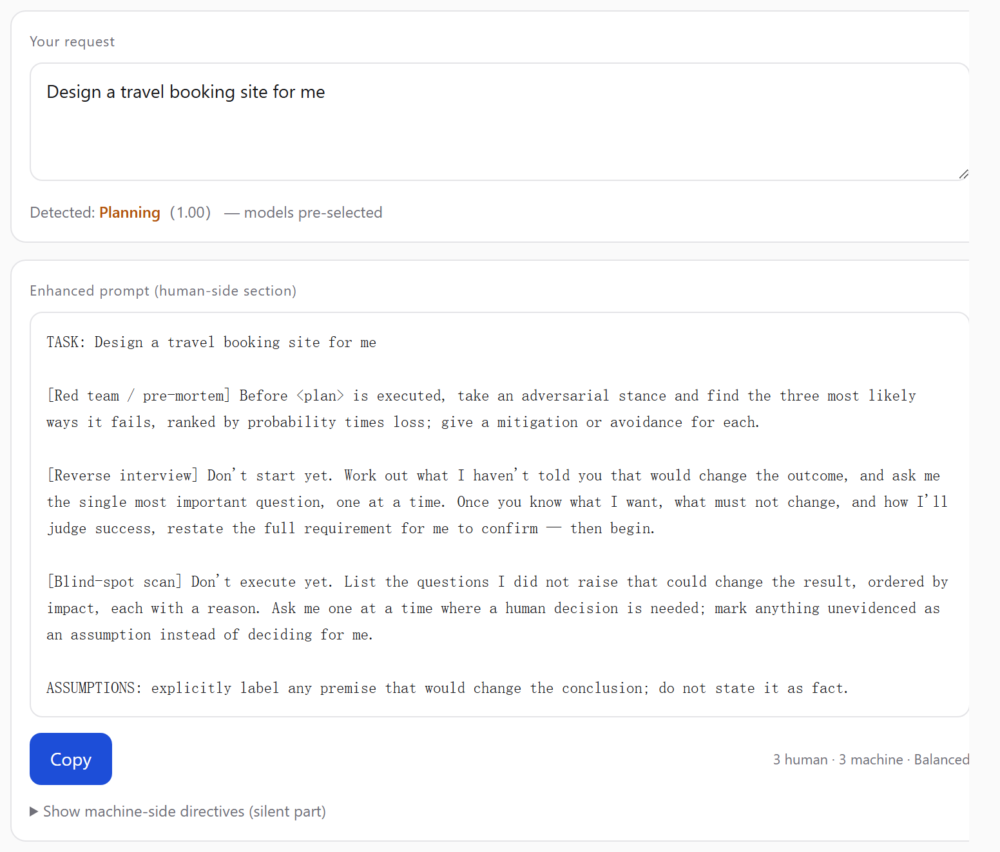

# Getting started — host by host

Three ways in. They all produce the same constraints; pick by where you already work.

---

## 1. Claude Code / Claude Skills / WorkBuddy

**Install**

```bash
git clone https://github.com/<your-handle>/thought-kernel.git
mkdir -p ~/.claude/skills
cp -r thought-kernel/skill ~/.claude/skills/thought-kernel
```

**Verify** — the file must be at `~/.claude/skills/thought-kernel/SKILL.md` and start with a `---` frontmatter block containing `name: thought-kernel`. If your host requires the folder name to match `name`, keep them identical (that is why the folder is `thought-kernel`, not `skill`).

**Use** — say it in plain language, no syntax needed:

| You say | What fires |
|---|---|
| "Learn X with me using Feynman technique" | H1, interactive flow, consent asked first |
| "Plan this — but don't give me a plan yet" | H4 reverse interview + H9 pre-mortem |
| "Should I take this offer?" | H6 both-sides argument, no recommendation |
| "Use efficiency mode from now on" | mode switch, session-scoped |
| "What's 2+2" | `skip` — gate blocks everything |

**Common failure:** installing into a project-level skills folder while the session was started before the folder existed. Restart the session; skills are scanned at start.

---

## 2. Cursor / Windsurf / any rules-based host

Copy the whole of `prompt/KERNEL.md` into your rules file:

```
.cursor/rules/thought-kernel.mdc
```

It is self-contained — no `@references/` links, no host-specific frontmatter. Nothing else to install.

**Trade-off:** you get the kernel and the scenario table, but not the five expanded scenario packs and not the per-mode token budgets. If you want those, use the skill install above.

---

## 3. Any model, no install

**Browser panel.** Open `demo/index.html` (or the Pages URL). Pick a mode, type the request, hit generate, copy the result into any chat. Works offline; no build step; no network calls.



The panel is bilingual — the toggle sits in the top-right corner. Scenario detection matches both Chinese and English input whichever language the interface is in, so you can leave it on English and paste a Chinese request.

**System prompt.** Paste `prompt/KERNEL.md` into a project's custom instructions or a system prompt field. For very small context windows, cut §5 (honesty rules) last — it is the part that produced the most measurable behaviour change, not the first to go.

---

## Choosing a mode

| Situation | Mode | Why |
|---|---|---|
| Chat, lookups, drafts, "just do it" | `efficiency` | fewer tokens, no framework on small asks |
| Default | `balanced` | ~60–70% of accuracy's size |
| Decisions, code you will ship, anything external-facing, money/legal/medical | `accuracy` | assumptions split into confirmed / unverified / missing |
| Irreversible or affects other people | forced `accuracy` | the gate overrides whatever mode you set |

Switch mid-session by saying so. Priority is: this message's explicit instruction → session instruction → default.

---

## What it will not do

- It will not make a weak model strong.
- It will not answer "improve my prompt" requests by rewriting your prompt into something you did not ask for — it adds constraints around it.
- It will not fire on every message. If you installed it and nothing seems to happen, check the gate: short factual questions are *supposed* to pass through untouched.

If it visibly misfires (adds a framework to a one-line question, or hand-backs a skeleton when you asked for a draft), that is a bug — please open an issue with the exact message. Gate failures are the highest-value bug reports this project gets.
